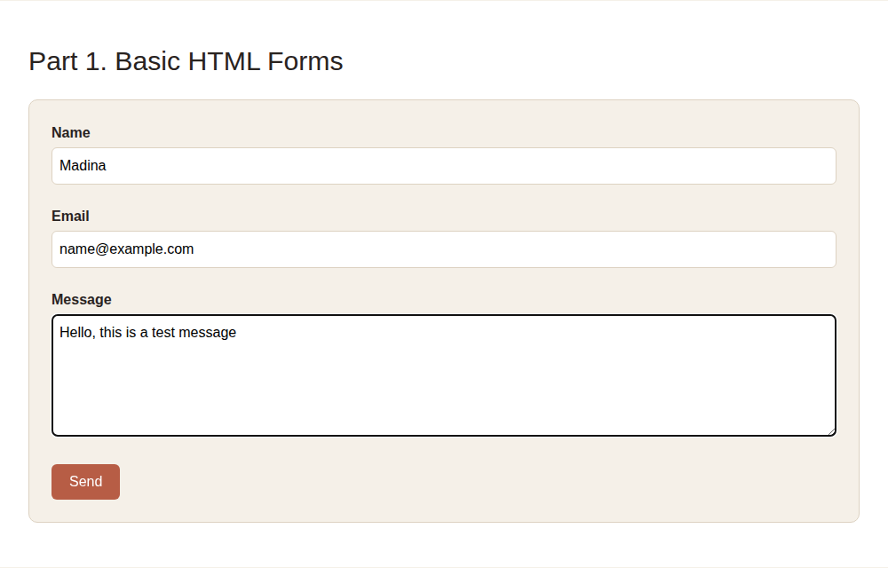
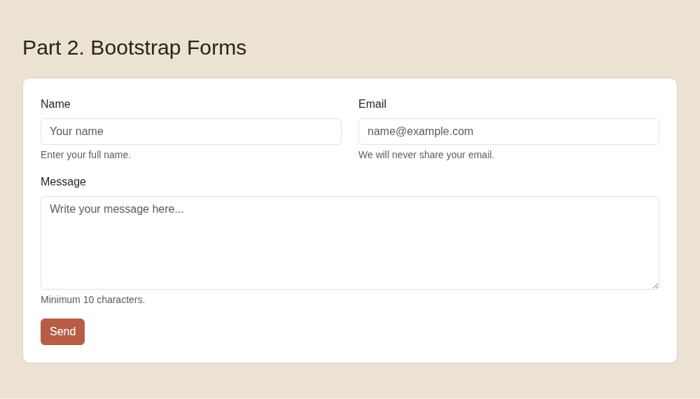
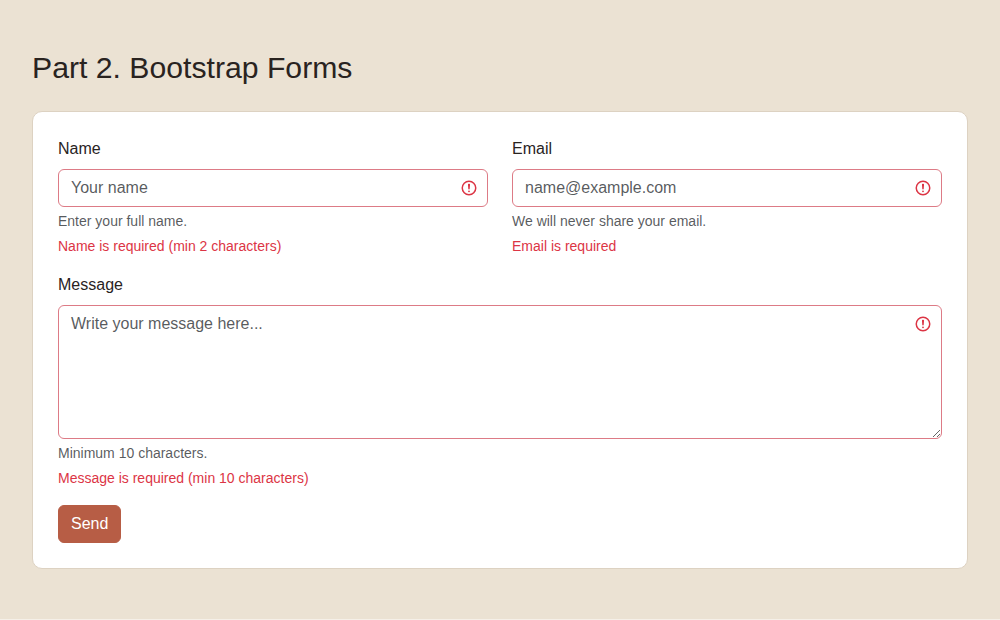
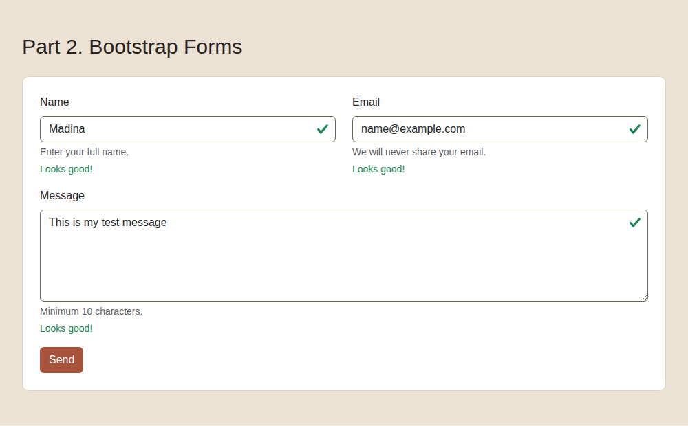
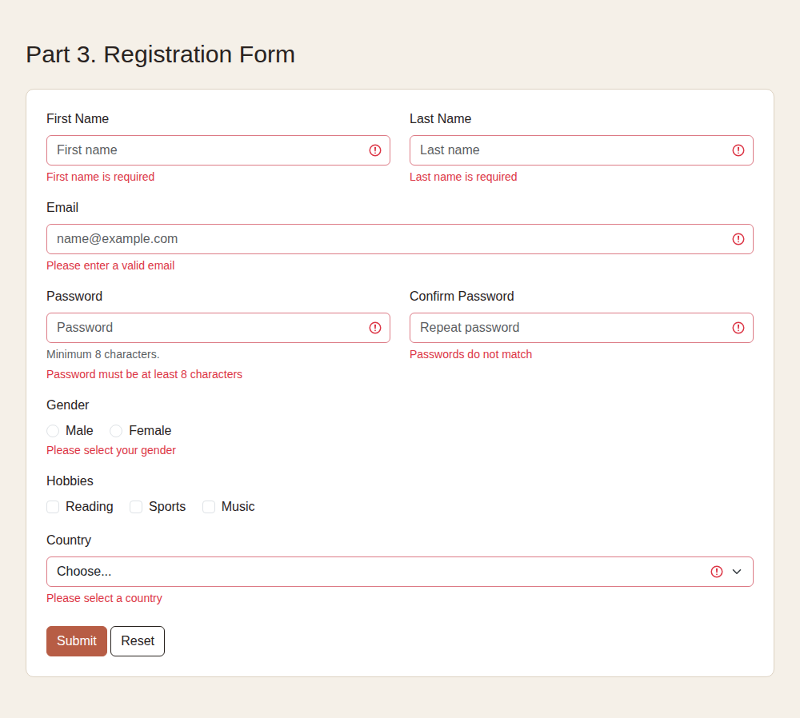
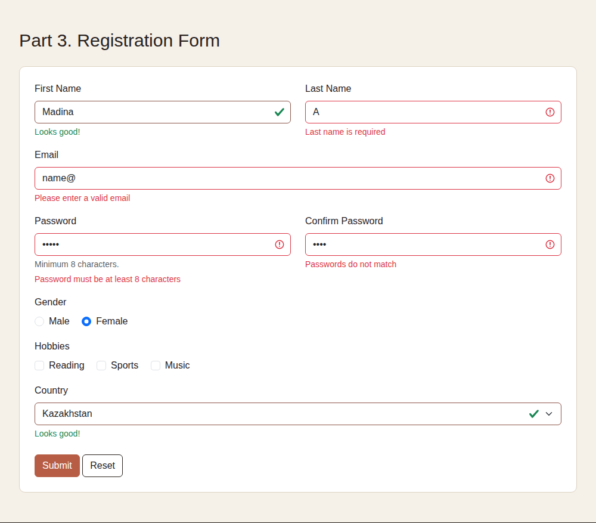
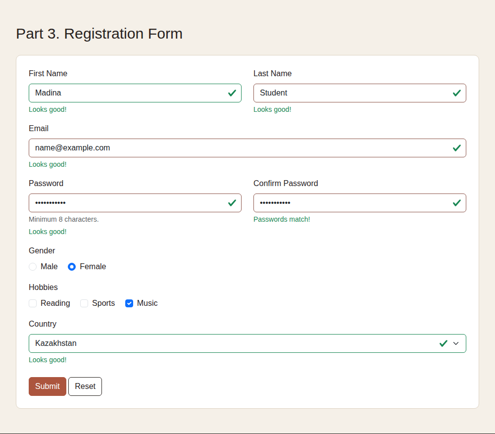
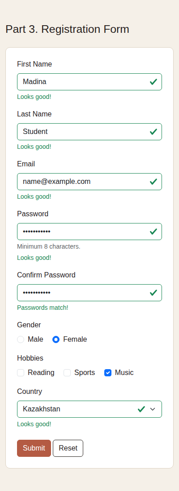

# Assignment 4. Forms and Validation

**Name:** Madina Sabyrgali
**Group:** IT-2503

**How to run:** open `index.html` in a browser. All parts are on one page.

---

## Part 1. Basic HTML Forms

### Task 0. Simple Contact Form

**Task:** Make a contact form with Name, Email, Message and a Submit button. Every field needs a label.

**What I did:** I made a simple form. Each input has an `id`, and each `<label>` has the same `for`.

### Task 1. Form with HTML5 Validation

**Task:** Add validation attributes and test them.

**What I did:** I added `required`, `type="email"`, `minlength` and `maxlength`. I tested an empty form and an email without `@`. The browser shows an error and does not send the form.

---

## Part 2. Bootstrap Forms

### Task 2. Bootstrap Form Styling

**Task:** Make the same form with Bootstrap. Use the grid, placeholders and helper text.

**What I did:** I used `form-label`, `form-control`, `form-text` and `btn btn-primary`. Name and Email are in one row (`col-md-6`).

### Task 3. Bootstrap Validation Styles

**Task:** Use `is-valid` and `is-invalid` with messages under the inputs. Test valid and invalid data.

**What I did:** On submit, JavaScript checks each field with `checkValidity()`. Then it adds `is-valid` or `is-invalid`. The messages are in `valid-feedback` and `invalid-feedback`.

Invalid data:

Valid data:

---

## Part 3. Registration Form

### Task 4. Registration Form

**Task:** Make a registration form with names, email, password, confirm password, gender, hobbies, country, Submit and Reset. Use the Bootstrap grid and validation.

**What I did:**
- The grid (`row`, `col-md-6`) makes the form responsive.
- HTML5 attributes: `required`, `type="email"`, `minlength="8"` for the password.
- `is-valid` and `is-invalid` show the result.
- JS checks that Confirm Password is the same as Password (`setCustomValidity`).
- JS checks that a gender is selected.
- The Reset button removes the green and red marks.

Empty form:

Wrong data:

Correct data:

Mobile view:

---

## Summary

I started with a simple HTML form and added validation attributes. Then I made the form with Bootstrap and added `is-valid` and `is-invalid` with a little JavaScript. In the last part I made a registration form with password check, radio buttons, checkboxes and a select.
